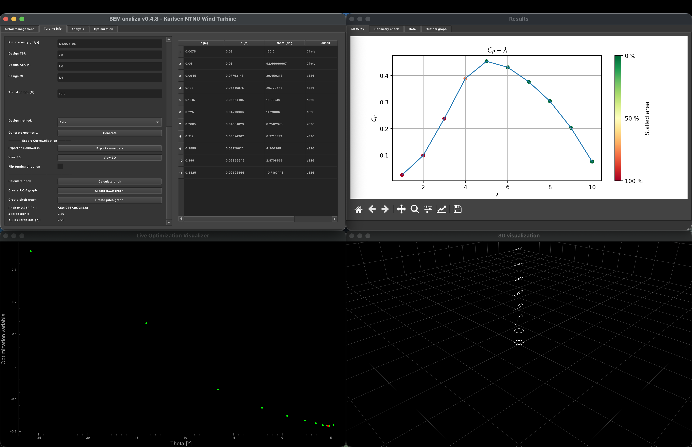

# Python BEM

Python BEM is a Blade Element Momentum Theory tool for wind turbines and propellers.

This README is an implementation reference for the current codebase. The equations below are written from the actual solver and helper modules, primarily `calculation.py`, `popravki.py`, `utils.py`, `montgomerie.py`, and `optimization.py`.

## What The Program Does

The software:

- manages airfoil polar data,
- extrapolates airfoil polars to 360 degrees,
- generates preliminary blade geometry,
- solves blade sections with BEM,
- combines section results into rotor-level performance,
- performs simple structural post-processing,
- and runs numerical optimization of blade geometry.

## Installation And Launch

### Requirements

- Python 3
- packages from `requirements.txt`

### Install

```bash
pip install -r requirements.txt
```

### Run

```bash
python bem.py
```

### Build Executable

```bash
pyinstaller main.spec
```

### macOS Note For XFOIL

```bash
brew install xquartz
```

## Code Map

- `calculation.py`: main BEM solver and post-processing
- `popravki.py`: induction-factor and correction models
- `utils.py`: interpolation and geometry-generation helpers
- `montgomerie.py`: 360 degree polar extrapolation
- `optimization.py`: section-wise and whole-blade optimization

## Notation

The same symbols are used below as in the code where practical.

| Symbol | Meaning | Units |
| --- | --- | --- |
| $R$ | tip radius | m |
| $R_{hub}$ | hub radius | m |
| $r$ | local section radius | m |
| $dr$ | section spanwise width | m |
| $B$ | number of blades | - |
| $c$ | local chord | m |
| $\theta$ | local twist angle | deg or rad depending on context |
| $p$ | blade pitch | deg |
| $v$ | freestream speed | m/s |
| $\Omega$ | angular speed | rad/s |
| $rpm$ | rotational speed | rev/min |
| $\lambda$ | tip-speed ratio | - |
| $\lambda_r$ | local tip-speed ratio | - |
| $a$ | axial induction factor | - |
| $a'$ | tangential induction factor | - |
| $\phi$ | relative-flow angle | rad or deg depending on context |
| $\alpha$ | angle of attack | rad or deg depending on context |
| $W$ | relative speed magnitude | m/s |
| $Re$ | Reynolds number | - |
| $\rho$ | fluid density | kg/m$^3$ |
| $\nu$ | kinematic viscosity | m$^2$/s |
| $C_l$ | lift coefficient | - |
| $C_d$ | drag coefficient | - |
| $C_n$ | normal-force coefficient | - |
| $C_t$ | tangential-force coefficient | - |
| $F$ | combined loss factor | - |
| $\Gamma_B$ | bound circulation proxy used in code | m$^2$/s |

## Solver Workflow

The main rotor calculation is `Calculator.run_array(...)` in `calculation.py`.

The code solves each blade section independently, then combines section results into rotor totals.

### 1. Rotor-Level Precomputation

The angular speed is

$$
\Omega = rpm \cdot \frac{2\pi}{60}
$$

The tip-speed ratio is

$$
\lambda = \frac{\Omega R}{v}
$$

For propeller reporting, the advance ratio is

$$
J = \frac{v}{(rpm/60) \cdot 2R}
$$

### 2. Section Geometry Quantities

For each section, the local tip-speed ratio is

$$
\lambda_r = \frac{\Omega r}{v}
$$

The local solidity is

$$
\sigma = \frac{cB}{2\pi r}
$$

Parameters:

- $\sigma$: local blade solidity
- $c$: local chord
- $B$: number of blades
- $r$: local radius

### 3. Velocity Components Used By The Code

The code allows yaw, tilt, and coning through the intermediate velocities $V_x$ and $V_y$:

$$
V_x = v\left[\left(\cos\gamma\sin\tau + \sin\gamma\right)\sin\psi + \cos\gamma\cos\psi\cos\tau\right]
$$

$$
V_y = \Omega r\cos\psi + v\left(\cos\gamma\sin\tau - \sin\gamma\right)
$$

where:

- $\gamma$: yaw angle
- $\tau$: tilt angle
- $\psi$: coning angle

In the current implementation, the section-loop sets $\psi = 0$ by default.

### 4. Induced Velocity Components

For a wind turbine:

$$
U_n = V_x(1-a)
$$

$$
U_t = V_y(1+a')
$$

For a propeller:

$$
U_n = V_x(1+a)
$$

$$
U_t = V_y(1-a')
$$

The relative-flow angle is

$$
\phi = \operatorname{atan2}(U_n, U_t)
$$

The relative speed magnitude is

$$
W = \sqrt{U_n^2 + U_t^2}
$$

### 5. Reynolds Number

If Reynolds number is not forced by the user, the code computes

$$
Re = \frac{Wc}{\nu}
$$

If `fix_reynolds=True`, the user-supplied constant Reynolds number is used instead.

### 6. Tip And Hub Loss Factors

The total loss factor starts as

$$
F = 1
$$

and is multiplied by the selected loss models.

#### Prandtl Tip Loss

$$
F_{tip} = \frac{2}{\pi}\cos^{-1}\left[\exp\left(-\frac{B}{2}\left|\frac{R-r}{r\sin\phi}\right|\right)\right]
$$

#### Prandtl Hub Loss

The current code implements hub loss as

$$
F_{hub} = \frac{2}{\pi}\cos^{-1}\left[\exp\left(-\frac{B}{2}\left|\frac{(r-R_{hub})/r}{\sin\phi}\right|\right)\right]
$$

#### Modified Tip Loss

$$
F_{tip,new} = \frac{2}{\pi}\cos^{-1}\left[\exp\left(-\frac{B}{2}\left|\frac{(R-r)/r}{\sin\phi}\right|\left(e^{-0.15(B\lambda_r-21)}+0.1\right)\right)\right]
$$

#### Modified Hub Loss

$$
F_{hub,new} = \frac{2}{\pi}\cos^{-1}\left[\exp\left(-\frac{B}{2}\left|\frac{(R_{hub}-r)/r}{\sin\phi}\right|\left(e^{-0.15(B\lambda_r-21)}+0.1\right)\right)\right]
$$

### 7. Angle Of Attack

For a propeller:

$$
\alpha = (\theta + p) - \phi
$$

For a wind turbine:

$$
\alpha = \phi - (\theta + p)
$$

where $\theta$ and $p$ are converted to radians inside the solver before use.

### 8. Cascade Correction

If enabled, the angle of attack is corrected as

$$
\alpha_{corr} = \alpha + \Delta\alpha_1 + \Delta\alpha_2
$$

with

$$
\Delta\alpha_1 = \frac{1}{4}\left[\tan^{-1}\left(\frac{(1-a)v}{(1+2a')r\Omega}\right) - \tan^{-1}\left(\frac{(1-a)v}{r\Omega}\right)\right]
$$

$$
\Delta\alpha_2 = 0.109\,\frac{Bc\,t_{max}\,R\Omega/v}{Rc\sqrt{(1-a)^2 + (r\Omega/v)^2}}
$$

Parameters:

- $t_{max}$: maximum airfoil thickness used by the code for the section
- this correction is implemented in `cascadeEffectsCorrection(...)`

### 9. Airfoil Polar Lookup And Transition Blending

For a normal section, the solver interpolates

$$
C_l = C_l(Re, \alpha)
$$

$$
C_d = C_d(Re, \alpha)
$$

If the section is marked as a transition between two airfoils, the code blends them linearly:

$$
C_l = kC_{l,1} + (1-k)C_{l,2}
$$

$$
C_d = kC_{d,1} + (1-k)C_{d,2}
$$

where $k$ is the transition coefficient.

The same linear blending is used for stall bounds and the zero-lift angle.

### 10. Stall Flag

The code sets a section stall flag if the current angle of attack is outside the airfoil's interpolated attached-flow range:

$$
\alpha > \alpha_{stall,max}
\quad \text{or} \quad
\alpha < \alpha_{stall,min}
$$

### 11. Rotational Augmentation Correction

If enabled, the solver modifies lift using a potential-flow target lift

$$
C_{l,pot} = 2\pi\sin(\alpha - \alpha_0)
$$

and then computes

$$
C_{l,3D} = C_l + f_l(C_{l,pot} - C_l)
$$

$$
C_{d,3D} = C_d
$$

The function $f_l$ depends on the selected model.

#### Snel et al.

$$
f_l = a_s\left(\frac{c}{r}\right)^h
$$

with $a_s=3$, $h=2$.

#### Du And Selig

The code uses

$$
\gamma_* = \frac{\Omega R}{\sqrt{|v^2-(\Omega R)^2|}}
$$

and then evaluates the hard-coded expression in `calc_rotational_augmentation_correction(...)` for $f_l$ and $f_d$.

#### Chaviaropoulos And Hansen

$$
f_l = a_h\left(\frac{c}{r}\right)^h\cos^n\theta
$$

with $a_h=2.2$, $h=1$, $n=4$.

#### Lindenburg

$$
f_l = a_l\left(\frac{\Omega R}{W}\right)^2\left(\frac{c}{r}\right)^h
$$

with $a_l=3.1$, $h=2$.

#### Dumitrescu And Cardos

$$
f_l = 1 - \exp\left(-\frac{g_d}{r/c - 1}\right)
$$

with $g_d=1.25$.

#### Snel-Type Propeller Correction

$$
f_l = \left(\frac{\Omega r}{W}\right)^2\left(\frac{c}{r}\right)^2 1.5
$$

#### Gur And Rosen

For $\alpha \ge 8^\circ$:

$$
f_l = \tanh\left(10.73\frac{c}{r}\right)
$$

For $\alpha_0 < \alpha < 8^\circ$:

$$
f_l = 0
$$

For $\alpha \le \alpha_0$:

$$
f_l = -\tanh\left(10.73\frac{c}{r}\right)
$$

### 12. Mach Number Correction

If enabled, the code applies

$$
C_l \leftarrow \frac{C_l}{\sqrt{1-M^2}}
$$

$$
C_d \leftarrow \frac{C_d}{\sqrt{1-M^2}}
$$

with the tip Mach number approximated as

$$
M = \frac{\Omega R}{343}
$$

### 13. Circulation Proxy

The code computes

$$
\Gamma_B = \frac{1}{2}WcC_l
$$

This is later used in the optional wake-rotation quantity

$$
k = \frac{\Omega \Gamma_B}{\pi v^2}
$$

$$
a'_{vct} = \frac{k}{4\lambda_r^2}
$$

The value $a'_{vct}$ is calculated but not used as the final tangential induction value.

### 14. Normal And Tangential Aerodynamic Coefficients

For a propeller:

$$
C_n = C_l\cos\phi - C_d\sin\phi
$$

$$
C_t = C_l\sin\phi + C_d\cos\phi
$$

For a wind turbine:

$$
C_n = C_l\cos\phi + C_d\sin\phi
$$

$$
C_t = C_l\sin\phi - C_d\cos\phi
$$

### 15. Section Lift, Drag, Normal Force, And Tangential Force

Lift and drag on a blade element are

$$
dF_L = \frac{1}{2}\rho W^2 c\,dr\,C_l
$$

$$
dF_D = \frac{1}{2}\rho W^2 c\,dr\,C_d
$$

The code then resolves them as

$$
dF_t = dF_L\sin\phi - dF_D\cos\phi
$$

$$
dF_n = dF_L\cos\phi + dF_D\sin\phi
$$

The local thrust coefficient used by the induction models is

$$
C_{T,r} = \frac{\sigma(1-a)^2 C_n}{\sin^2\phi}
$$

### 16. Induction-Factor Models

The solver supports six implementations from `popravki.py`.

#### Method 0: Classic BEM

$$
a = \frac{\sigma C_n}{4F\sin^2\phi + \sigma C_n\,s_p}
$$

$$
a' = \frac{\sigma C_t}{4F\sin\phi\cos\phi - \sigma C_t\,s_p}
$$

where $s_p$ is the sign coefficient called `prop_coeff` in the code.

#### Method 1: Spera Correction

Base formula:

$$
a = \frac{\sigma C_n}{4F\sin^2\phi + \sigma C_n}
$$

If $a \ge 0.2$, the code switches to

$$
a_c = 0.2
$$

$$
K = \frac{4F\sin^2\phi}{\sigma C_n}
$$

$$
a = 1 + \frac{1}{2}K(1-2a_c) - \frac{1}{2}\sqrt{\left[K(1-2a_c)+2\right]^2 + 4(K a_c^2 - 1)}
$$

Tangential induction:

$$
a' = \frac{\sigma C_t}{4F\sin\phi\cos\phi - \sigma C_t}
$$

#### Method 2: Buhl Correction Used By AeroDyn

If

$$
C_{T,r} > 0.96F
$$

then

$$
a = \frac{18F - 20 - 3\sqrt{C_{T,r}(50 - 36F) + 12F(3F-4)}}{36F - 50}
$$

otherwise

$$
a = \left(1 + \frac{4F\sin^2\phi}{\sigma C_n}\right)^{-1}
$$

and

$$
a' = \left(-1 + \frac{4F\sin\phi\cos\phi}{\sigma C_t}\right)^{-1}
$$

#### Method 3: QBlade-Style Buhl Correction

If

$$
C_{T,r} \le 0.96F
$$

then

$$
a = \frac{1}{4F\sin^2\phi/(\sigma C_n) + 1}
$$

otherwise

$$
a = \frac{18F - 20 - 3\sqrt{|C_{T,r}(50 - 36F) + 12F(3F-4)|}}{36F - 50}
$$

The code then sets

$$
a' = \frac{1}{2}\left(\sqrt{\left|1 + \frac{4a(1-a)}{\lambda_r^2}\right|} - 1\right)
$$

#### Method 4: Wilson And Walker

With $a_c = 0.2$:

If

$$
C_{T,r} \le 0.64F
$$

then

$$
a = \frac{1 - \sqrt{1 - C_{T,r}/F}}{2}
$$

otherwise

$$
a = \frac{C_{T,r} - 4Fa_c^2}{4F(1-2a_c)}
$$

and

$$
a' = \left(\frac{4F\sin\phi\cos\phi}{\sigma C_t} - 1\right)^{-1}
$$

#### Method 5: Modified ABS Model

If

$$
C_{T,r} < 0.96F
$$

then

$$
a = \frac{1 - \sqrt{1 - C_{T,r}/F}}{2}
$$

otherwise

$$
a = 0.1432 + \sqrt{-0.55106 + 0.6427\frac{C_{T,r}}{F}}
$$

Then the code computes

$$
a'' = \frac{4aF(1-a)}{\lambda_r^2}
$$

and

$$
a' = \frac{\sqrt{1+a''} - 1}{2}
$$

If $1+a'' < 0$, the implementation sets $a'=0$.

### 17. Relaxation And Convergence

The iterative solver converges when both induction changes satisfy

$$
|a-a_{last}| < \varepsilon
$$

$$
|a'-a'_{last}| < \varepsilon
$$

where $\varepsilon$ is `convergence_limit`.

If not yet converged, the relaxed update is

$$
a \leftarrow a_{last}(1-f_r) + a f_r
$$

$$
a' \leftarrow a'_{last}(1-f_r) + a' f_r
$$

where $f_r$ is `relaxation_factor`.

### 18. Optional Skewed-Wake Correction

The code uses

$$
\chi = (0.6a+1)\gamma
$$

$$
a_{skew} = a\left(1 + \frac{15\pi}{64}\frac{r}{R}\tan\frac{\chi}{2}\right)
$$

where $\gamma$ is the yaw angle in radians.

### 19. Thrust And Torque Equations In The Code

The solver computes both momentum-theory and blade-element expressions.

#### Wind Turbine Momentum-Theory Forms

$$
dT_{MT} = F\,4\pi r\rho v^2 a(1-a)dr
$$

$$
dQ_{MT} = F\,4a'(1-a)\rho v\pi r^3\Omega\,dr
$$

#### Wind Turbine Blade-Element Forms

$$
dT_{BET} = \frac{1}{2}\rho BcW^2 C_n\,dr
$$

$$
dQ_{BET} = \frac{1}{2}\rho BcW^2 C_t\,r\,dr
$$

#### Propeller Momentum-Theory Forms

$$
dT_{MT,p} = 4\pi r\rho v^2 (1+a)a\,dr
$$

$$
dQ_{MT,p} = 4\pi r^3 \rho v\Omega (1+a)a'\,dr
$$

#### Propeller Blade-Element Forms

$$
dT_{BET,p} = \frac{1}{2}\rho v^2 cB\frac{(1+a)^2}{\sin^2\phi}C_n\,dr
$$

$$
dQ_{BET,p} = \frac{1}{2}\rho v cB\Omega r^2\frac{(1+a)(1-a')}{\sin\phi\cos\phi}C_t\,dr
$$

#### Which Equations Are Returned

- for wind turbines, the implementation returns `dT = dT_BET` and `dQ = dQ_BET`
- for propellers, the implementation returns `dT = dT_MT_p` and `dQ = dQ_MT_p`

### 20. Wake Speeds Stored In Results

For propellers:

$$
U_1 = v
$$

$$
U_3 = U_1(1+a)
$$

$$
U_4 = U_1(1+2a)
$$

For wind turbines:

$$
U_1 = v
$$

$$
U_2 = U_1(1-a)
$$

$$
U_4 = U_1(1-2a)
$$

## Rotor-Level Integration And Performance

After all sections are solved, the code aggregates results.

### Forces And Torque

$$
F_t = \sum dF_t
$$

$$
dM = B\,dF_t\,r
$$

$$
M = \sum dM
$$

$$
Q = \sum dQ
$$

### Power

Two power-like quantities are formed in the code:

$$
P_Q = Q\Omega
$$

$$
P_M = M\Omega
$$

The stored output `power` is

$$
P = M\Omega
$$

### Wind-Turbine Power Coefficient

The available flow power is

$$
P_{max} = \frac{1}{2}\rho v^3 \pi R^2
$$

The reported wind-turbine power coefficient is

$$
C_{P,wind} = \frac{P}{P_{max}}
$$

### Thrust Coefficients

For wind turbines:

$$
C_{T,wind} = \frac{T}{0.5\rho v^2 \pi R^2}
$$

For propellers:

$$
C_{T,prop} = \frac{T}{\rho (2R)^4 (rpm/60)^2}
$$

### Propeller Power And Torque Coefficients

The code computes

$$
C_{P,prop} = \frac{P_Q}{\rho (rpm/60)^3 (2R)^5}
$$

$$
C_q = \frac{Q}{\rho (2R)^5 (rpm/60)^2}
$$

### Propeller Efficiency

The reported efficiency is

$$
\eta_p = \frac{J}{2\pi}\frac{C_{T,prop}}{C_q}
$$

### Blade Stall Percentage

The code reports

$$
s_p = \frac{\sum stall_i}{N}
$$

where `stall_i` is 1 for a stalled section and 0 otherwise.

## Structural Post-Processing

`Calculator.statical_analysis(...)` performs simple beam-style post-processing.

### Section Mass

Using the cross-sectional area $A$ from the airfoil geometry routine:

$$
m_{sec} = A\,dr\,\rho_m
$$

where $\rho_m$ is the blade material density.

### Section Bending Moments

For section $i$, the code accumulates loads from section $i$ to the tip:

$$
M_{s,n}(i) = \sum_{j=i}^{N} dF_n(j)\,[r(j)-r(i)]
$$

$$
M_{s,t}(i) = \sum_{j=i}^{N} dF_t(j)\,[r(j)-r(i)]
$$

### Bending Stress

With extreme-fiber distances from the section centroid:

$$
\sigma_n = \frac{y_{max} M_{s,n}}{I_x}
$$

$$
\sigma_t = \frac{x_{max} M_{s,t}}{I_y}
$$

The code converts these to MPa by dividing by $10^6$ after using SI inertias.

### Centrifugal Force And Axial Stress

For each inboard section $i$, the code sums centrifugal contributions from section $i$ to the tip:

$$
v_{tan} = r\Omega
$$

$$
F_{c,sec} = m_{sec}\frac{v_{tan}^2}{r}
$$

$$
F_c(i) = \sum_{j=i}^{N} F_{c,sec}(j)
$$

$$
\sigma_c = \frac{F_c}{A}
$$

### Von Mises Stress

The code uses the three normal stresses

$$
\sigma_1 = \sigma_n,
\quad
\sigma_2 = \sigma_t,
\quad
\sigma_3 = \sigma_c
$$

and computes

$$
\sigma_{vm} = \sqrt{0.5(\sigma_1-\sigma_2)^2 + (\sigma_2-\sigma_3)^2 + (\sigma_3-\sigma_1)^2}
$$

## Airfoil Data Interpolation

The helper `interp(...)` in `utils.py` performs:

1. linear interpolation in angle of attack for the lower Reynolds curve,
2. linear interpolation in angle of attack for the upper Reynolds curve,
3. linear interpolation between those two Reynolds levels.

If the requested Reynolds number lies outside the available range, the nearest available Reynolds slice is used.

## Montgomerie 360 Degree Polar Extrapolation

`montgomerie.py` extends airfoil polars beyond the measured range.

### Base Quantities

At initialization, the code estimates:

$$
C_{L0} = C_l(\alpha=0)
$$

$$
\alpha_0: C_l(\alpha_0)=0
$$

### Drag At 90 Degrees

$$
C_{D90}(\alpha) = C_{D90,base} - 1.46\frac{t}{2} + 1.46f_c\sin\left(\alpha\frac{2\pi}{360}\right)
$$

where:

- $t$: airfoil thickness proxy from the coordinate set,
- $f_c$: hard-coded camber proxy in the implementation,
- `m_CD90` is the user-configurable base drag-at-90-deg value.

### Potential-Flow And Plate-Flow Forms

Potential-flow lift is modeled as

$$
C_{L,pot} = C_{L0} + s\alpha
$$

where $s$ is the user-supplied slope parameter.

Flat-plate style lift is implemented as `PlateFlow(...)`:

$$
C_{L,plate} = \left(1 + \frac{C_{L0}}{\sin(\pi/4)}\sin\alpha\right)C_{D90}(\alpha)\sin\Theta\cos\Theta
$$

with the internal angle expression

$$
\Theta = \alpha - 57.6\cdot 0.08\sin\alpha - \alpha_0\cos\alpha
$$

where the code evaluates the trigonometric terms in degree-based form.

Flat-plate drag is

$$
C_{D,plate} = C_{D90}(\alpha)\sin^2\alpha
$$

### Blend Function Used In Extrapolation

The extrapolation repeatedly uses a fourth-order blend:

$$
f = \frac{1}{1 + k\Delta^4}
$$

and forms the blended lift as

$$
C_l = fC_{L,pot} + (1-f)C_{L,plate}
$$

or, in the rear-side regions, uses the same idea with a shifted potential-flow branch around $180^\circ$.

### Drag During Extrapolation

The code adds an extra drag term

$$
\Delta C_D = 0.13\left[(f-1)C_{L,pot} - (1-f)C_{L,plate}\right]
$$

for the positive branch and the analogous signed expression for the negative branch, then evaluates

$$
C_d = f\left(\Delta C_D + 0.006 + 1.25\frac{t^2}{180}|\alpha|\right) + (1-f)C_{D,plate} + 0.006
$$

The code generates values from $1^\circ$ to $180^\circ$ and from $0^\circ$ down to $-180^\circ$.

## Geometry Generation Reference

The GUI includes geometry generators in `utils.py`.

### Betz Chord Distribution

$$
c = \frac{16\pi R}{9BC_{l,max}}\left(TSR\sqrt{TSR^2\left(\frac{r}{R}\right)^2 + \frac{4}{9}}\right)^{-1}
$$

### Schmitz Chord Distribution

$$
c = \frac{16\pi r}{BC_{l,max}}\sin^2\left(\frac{1}{3}\tan^{-1}\frac{R}{TSR\,r}\right)
$$

### Betz Twist Distribution

$$
\theta = \tan^{-1}\left(\frac{2R}{3r\,TSR}\right) - \alpha_d
$$

The code returns this in degrees.

### Schmitz Twist Distribution

$$
\theta = \frac{2}{3}\tan^{-1}\left(\frac{R}{r\,TSR}\right) - \alpha_d
$$

Again, the code returns degrees.

### Larrabee Propeller Generator

The implementation computes:

$$
\xi = \frac{r}{R}
$$

$$
\Omega = RPM\cdot\frac{2\pi}{60}
$$

$$
x = \frac{\Omega r}{v}
$$

$$
TSR = \frac{v}{\Omega R}
$$

$$
f = \frac{B}{2}\left(\frac{\sqrt{TSR^2+1}}{TSR}\right)\left(1-\frac{r}{R}\right)
$$

$$
F = \frac{2}{\pi}\cos^{-1}(e^{-f})
$$

$$
G = F\frac{x^2}{1+x^2}
$$

$$
y = G\left(1-\frac{\epsilon}{x}\right)\xi
$$

$$
y_2 = G\left(1-\frac{\epsilon}{x}\right)\frac{\xi}{x^2+1}
$$

$$
I_1 = 4\int y\,d\xi
$$

$$
I_2 = 2\int y_2\,d\xi
$$

$$
C_T = \frac{2T}{\rho v^2 \pi R^2}
$$

$$
\zeta = \frac{I_1}{2I_2}\left(1-\sqrt{1-\frac{4I_2C_T}{I_1^2}}\right)
$$

$$
\frac{c}{R} = \frac{4\pi}{B}TSR\frac{G}{\sqrt{1+x^2}}\frac{\zeta}{C_l}
$$

$$
c = R\frac{c}{R}
$$

$$
\theta = \tan^{-1}\left(\frac{TSR}{\xi}\left(1+\frac{\zeta}{2}\right)\right)
$$

where $\epsilon$ is the drag-to-lift ratio passed into the function.

### Adkins Propeller Generator

The Adkins generator in `utils.py` is iterative. The implemented steps are:

$$
\xi = \frac{r}{R}
$$

$$
x = \frac{\Omega r}{v}
$$

$$
\lambda = \frac{v}{\Omega R}
$$

$$
\phi_t = \tan^{-1}\left(\lambda\left(1+\frac{\zeta}{2}\right)\right)
$$

$$
\phi = \tan^{-1}\left(\frac{\tan\phi_t}{\xi}\right)
$$

$$
f = \frac{B}{2}\frac{1-\xi}{\sin\phi_t}
$$

$$
F = \frac{2}{\pi}\cos^{-1}(e^{-f})
$$

$$
G = Fx\cos\phi\sin\phi
$$

$$
Wc = \frac{4\pi\lambda G vR\zeta}{BC_l}
$$

$$
Re = \frac{Wc}{\nu}
$$

For each section, the code either enforces a target $C_l$ or numerically minimizes

$$
\epsilon = \frac{C_d}{C_l}
$$

Then it computes

$$
a = \frac{\zeta}{2}\cos^2\phi\left(1-\epsilon\tan\phi\right)
$$

$$
a' = \frac{\zeta}{2x}\cos\phi\sin\phi\left(1+\frac{\epsilon}{\tan\phi}\right)
$$

$$
W = \frac{v(1+a)}{\sin\phi}
$$

$$
c = \frac{Wc}{W}
$$

$$
\beta = \alpha + \phi
$$

It also forms

$$
I_1' = 4\xi G(1-\epsilon\tan\phi)
$$

$$
I_2' = \lambda\left(\frac{I_1'}{2\xi}\right)\left(1+\frac{\epsilon}{\tan\phi}\right)\sin\phi\cos\phi
$$

$$
J_1' = 4\xi G\left(1+\frac{\epsilon}{\tan\phi}\right)
$$

$$
J_2' = \frac{J_1'}{2}(1-\epsilon\tan\phi)\cos^2\phi
$$

and integrates them spanwise to get $I_1$, $I_2$, $J_1$, and $J_2$.

If thrust is constrained:

$$
T_c = \frac{2T}{\rho v^2 \pi R^2}
$$

$$
\zeta_{new} = \frac{I_1}{2I_2} - \sqrt{\left(\frac{I_1}{2I_2}\right)^2 - \frac{T_c}{I_2}}
$$

If power is constrained:

$$
P_c = \frac{2P}{\rho v^3 \pi R^2}
$$

$$
\zeta_{new} = -\frac{J_1}{2J_2} + \sqrt{\left(\frac{J_1}{2J_2}\right)^2 + \frac{P_c}{J_2}}
$$

The iteration is relaxed as

$$
\zeta \leftarrow (1-f_r)\zeta + f_r\zeta_{new}
$$

and converges when the code-level condition

$$
|\zeta-\zeta_{new}|\,|\zeta_{new}| < \varepsilon
$$

is satisfied.

## Optimization Reference

`optimization.py` contains two optimization modes.

### Section-By-Section Optimization

For one section, the objective is

$$
f = -\sum_i w_i y_i + \sum_j w_j |z_j - z_{j,target}|
$$

where:

- $y_i$ are selected output variables to maximize,
- $z_j$ are selected output variables with targets,
- $w_i$ and $w_j$ are user-supplied coefficients.

The section optimizer uses `scipy.optimize.minimize(..., method="powell")`.

### Whole-Blade Optimization

The whole-blade mode parameterizes twist and chord with control points and reconstructs continuous distributions using:

- PCHIP interpolation when at least 3 control points are present,
- linear interpolation otherwise.

Depending on the selected objective mode, the code minimizes one of the following:

#### Minimize Torque At Target Thrust

$$
f = |Q| + PF\frac{|T-T_{target}|}{\max(|T_{target}|,1)}
$$

#### Maximize Thrust At Power Limit

$$
f = -|T| + PF\frac{\max(0, P-P_{max})}{\max(|P_{max}|,1)}
$$

#### Maximize $C_P$

$$
f = -C_P
$$

#### Maximize Efficiency At Target Thrust

$$
f = -\eta_p + PF\frac{|T-T_{target}|}{\max(|T_{target}|,1)}
$$

#### Weighted Custom Objective

$$
f = -\sum_i w_i y_i + \sum_j w_j |z_j-z_{j,target}|
$$

The penalty factor is

$$
PF = 10^5
$$

Additional penalties may be added for:

- exceeding the allowed stall percentage,
- exceeding a global power limit,
- violating a monotonic chord constraint after the maximum chord point.

The whole-blade mode uses either:

- `scipy.optimize.minimize(..., method="SLSQP")`, or
- `scipy.optimize.differential_evolution(...)`.

## Output Variables Produced By The Solver

The solver returns section arrays and rotor-level scalars including:

- induction factors: `a`, `a'`
- airfoil coefficients: `Cl`, `Cd`
- resolved coefficients: `Cn`, `Ct`
- angles: `alpha`, `phi`
- local factors: `F`, `lambda_r`, `Ct_r`, `Re`, `Vrel_norm`
- forces: `dFn`, `dFt`, `dT`, `dQ`, `dM`
- wake speeds: `U1`, `U2`, `U3`, `U4`
- rotor totals: `thrust`, `Q`, `M`, `power`, `cp`, `ct`, `cq`, `eff`
- structural outputs: `Ix`, `Iy`, `Ixy`, `A`, `Ms_n`, `Ms_t`, `stress_norm`, `stress_tang`, `stress_cent`, `stress_von_mises`

The full list is defined in `OUTPUT_VARIABLES_LIST` in `calculation.py`.

## Important Implementation Notes

- This README documents the code as implemented, not an idealized textbook BEM derivation.
- Some formulas differ between wind-turbine and propeller branches by sign convention and by which thrust/torque expression is finally stored.
- The hub-loss implementation uses its current in-code angle handling exactly as written.
- The Adkins and Montgomerie parts are iterative and partially empirical; their equations above are intended as a code reference.

## License

Python BEM - Blade Element Momentum Theory Software.

Copyright (C) 2022 M. Smrekar

This program is free software: you can redistribute it and/or modify
it under the terms of the GNU General Public License as published by
the Free Software Foundation, either version 3 of the License, or
(at your option) any later version.

This program is distributed in the hope that it will be useful,
but WITHOUT ANY WARRANTY; without even the implied warranty of
MERCHANTABILITY or FITNESS FOR A PARTICULAR PURPOSE. See the
GNU General Public License for more details.

You should have received a copy of the GNU General Public License
along with this program. If not, see <https://www.gnu.org/licenses/>.
